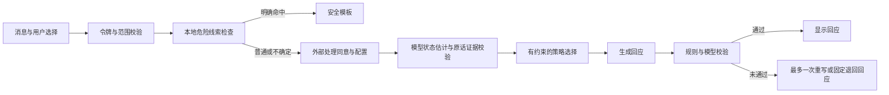

# C-CARE 开发与运行说明

当前交付是可运行的本地内部评审原型：真实登录凭证、独立个人支持入口、C-CARE 处理流程、合成案例诊断。没有接入真实模型，没有开展真人研究，也没有专业审查通过结论。

## 运行

建议 Python 3.12。在仓库根目录执行：

```powershell
py -3.12 -m venv .venv
.\.venv\Scripts\python.exe -m pip install -r backend/requirements-ccare.lock.txt
.\.venv\Scripts\python.exe backend/start.py --mode demo
```

打开 `http://127.0.0.1:8000`，创建只供演示的账号。当前机器另有已经启动的 `http://127.0.0.1:8765`。`demo` 只返回标明来源的固定模板。无参数启动时默认 `disabled`，普通对话返回模型未启用；明确危险线索仍走本地安全模板。

服务只监听本机。暂不支持手机快应用联调或公网访问。旧 `src/` 快应用仍保留，尚未迁移到新协议，不能把旧客户端与新后端混用。旧后端入口 `app.legacy_main` 已加启动阻断；源码留作后续迁移参考。

## 数据边界

- 新建 `backend/data/ccare_auth.db`，只存账号、带随机盐的密码哈希、令牌摘要和到期时间。旧数据库、档案 Markdown 与家庭卡片不读取、不迁移、不覆盖。
- 对话只在页面内存中保存；每次请求携带最近最多 20 条历史，总历史字符数最多 16000。本轮消息单独传递。刷新、清空、退出会清除本页对话。
- 后端不保存消息、模型状态或生成草稿。个人支持入口不调用家庭检索、档案提取、卡片提取或声音克隆。
- 令牌只在页面内存中，服务端保存 SHA-256 摘要，一小时到期；再次登录使旧令牌失效。忽略旧 `X-User-Id` 身份头。
- 删除账号会删除本地账号与会话记录。自行导出的文件、旧系统数据、系统备份及外部服务商数据不会随之删除。SQLite 逻辑删除不等于对存储介质和备份作法证级擦除。
- “暂停”会停止页面接收；已经送达外部服务的请求可能继续处理。撤回外部处理勾选阻止后续发送，不声称能撤回服务商已收到的数据。
- 本地监听、来源检查、请求上限及进程内限流仅适用于当前评审部署，不能据此宣称已达到生产安全要求。

## C-CARE 的当前实现



`listen / clarify / ground / draft` 对应倾听、澄清、短暂稳定和可修改草稿。明确拒绝建议或和解时保留倾听；识别到家庭不安全且用户请求草稿时，保守退回倾听。不会代发消息、默认联系父母或自动建立家庭共享记忆。

状态模型只能返回固定结构；具体判断必须引用用户原话。这里仅检查引用是否确实出现，尚不能证明引用支持该判断。校验器使用单独调用，但仍可与生成器共用模型，存在相关错误，不能当作独立专业审核。

通常需要 3 次模型调用，最多 5 次。每次默认 12 秒，整轮最多 45 秒。记录实际返回的 token 用量；缺失或调用失败时记 `null`，不写成 0。外部模式发生结构错误、校验失败或超时时显示固定退回回应，不展示未经检查的生成文本。

关键词规则会误报否定或转述，也可能漏掉隐晦表达、服药急症等情境。安全模板尚待专业人员审阅。此阶段不能开放真实心理求助服务。

## 接入真实模型前

1. 仓库历史中存在已暴露凭证。由持有者在原服务商控制台撤销旧密钥并核查使用记录；本次未读取其值、未尝试使用、未撤销，也未重写 Git 历史。签名私钥也需持有者核实用途并决定轮换。
2. 复制 `backend/.env.local.example` 为 `backend/.env.local`，手工填入新密钥、HTTPS 接口地址、模型名、服务商名称与真实隐私说明网址。不要在聊天里发送密钥。新配置使用 `KINVOICE_` 前缀；旧 `.env` 不会自动加载。
3. 明确服务商保留期限、训练用途、地域及删除途径。用户每次勾选外部处理同意后才发送普通对话。当前记录仅为请求级布尔值，尚未建立生产级版本化同意凭据。
4. 用合成数据做低预算连通检查，再做预先冻结的对照。专业审阅和伦理判定完成前，不招募真实困扰者，不导入咨询记录。

## 检查与开发诊断

```powershell
.\.venv\Scripts\python.exe scripts/check_ccare.py
node --check backend/app/ccare/web/app.js
.\.venv\Scripts\python.exe scripts/evaluate_ccare.py
```

诊断脚本要求已提交的工作区，避免代码版本无法追溯；开发调试可显式加 `--allow-dirty` 并记录脏状态。输出位于唯一的 `experiments/<UTC时间>-<随机ID>/`，含配置、数据及代码哈希、环境、逐例结果；不会覆盖历史结果。20 条合成开发数据未经专家审核，不能作为独立测试集。

CI 只执行离线测试和开发规则诊断，不读取模型密钥，不外发对话。当前测试使用临时数据库、合成身份及模拟模型；临时数据清理由测试框架处理。

## 接着做什么

| 顺序 | 任务 | 验收条件 | 当前依赖 |
|---|---|---|---|
| 1 | 专业审阅状态标签、策略边界和安全模板 | 审阅人、日期、逐条意见可追溯 | 用户正在寻找合作人员 |
| 2 | 新模型连通、限额和账单记录 | 真实调用数与 token 对得上；失败如实记录 | 撤销旧密钥并配置新密钥 |
| 3 | 强提示词、预算对齐、完整 C-CARE、逐项消融 | 同一冻结输入、模型和预算口径；单独报告安全拒绝率 | 合规数据与实验协议冻结 |
| 4 | 独立测试集和双人标注 | 母案例隔离、争议裁决、一致性统计 | 专业人员及合法数据来源 |
| 5 | 快应用迁移 | 新登录、暂停、隐私选择、删除与失效流程真机通过 | 原型协议稳定及工具链恢复 |
| 6 | 经审查后的小规模成人可用性研究 | 知情同意、退出、风险处置、保留期限可执行 | 伦理判定及专业安全支持 |
| 7 | 参赛报告与演示 | 每项结论能指向代码、原始记录或明确的计划 | 报名与专业合作状态待核 |

采用完整 C-CARE 是否优于强基线仍是假设。获奖目标不改变证据标准。
