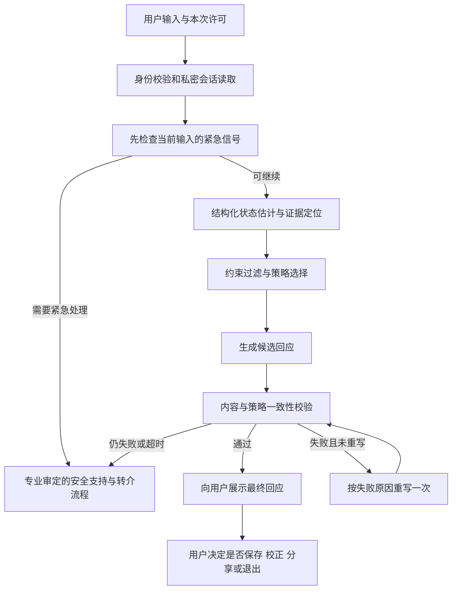

# KinVoice → C-CARE：AIC 2026 实施路线图

核查日期：2026-10-23（北京时间）
目标：AI+心理健康赛道国家一等奖；本文件不预测获奖概率。
状态：完成代码核查和实施设计；尚未实施 C-CARE、训练模型、开展用户研究或测得心理支持效果。

## 1. 判断与证据边界

**KinVoice 可以作为产品原型继续升级，但当前代码不足以支撑“安全、有效的亲子冲突心理支持系统”这一结论。最先要解决的是身份认证、私密数据隔离和长对话错误，然后才进入 C-CARE 算法对照。**

本次克隆了公开仓库默认分支 `The-final-branch`，固定提交为 `740412c29bdc9442a7a52b076f282c724c9c20b9`，提交日期为 2026-07-06。核查覆盖文件清单、核心接口、提示词、数据读写和调用参数，并做了离线合成数据检查。其他分支、线上部署、真实用户量和实际应用效果均未核实。[仓库快照](https://github.com/qiyuxi24/KinVoice/tree/740412c29bdc9442a7a52b076f282c724c9c20b9)

| 标记 | 含义 | 本次例子 |
|---|---|---|
| 已核实 | 有代码、官方文件或实际检查记录 | 无登录凭证可修改本地测试笔记 |
| 用户给定 | 本次任务明确提出的方向 | 18–25 岁大学生、亲子冲突、C-CARE |
| 计划 | 尚未实施的工作、规模或门槛 | 增加安全校验、构建独立测试集 |
| 假设 | 必须用实验检验 | 约束式策略选择优于强提示词基线 |
| 待核 | 当前证据不足 | 报名状态、部署状态、专家参与、密钥是否仍有效 |

前序聊天工具只返回了提问及回答占位符，旧回答正文无法恢复。本文件以本次用户给定目标为准，不补写此前讨论。用户表示“我正在找”；专业支持按寻找中安排，报名是否完成仍待核。

配套文件：`KinVoice_代码核查与证据_2026-10-23.md`、`KinVoice_数据与实验方案_2026-10-23.md`、`KinVoice_核查记录_2026-10-23.json`。后续改版新增 v2，保留本版。

## 2. 赛事时间与材料要求

**官方调整通知规定：报名、缴费、作品提交均于 2026-10-30 20:00 截止。**今天到截止仅约一周。官方赛题页允许晋级总决赛的作品继续完善；复赛预计 11 月上旬，总决赛预计 11 月底至 12 月上旬，具体安排另行通知。[赛程调整通知](https://www.aicomp.cn/notice/notice-3/5435.html)；[赛题通知](https://www.aicomp.cn/notice/notice-3/3979.html)

以下为官方附件要求的精简转述。附件中的百度网盘方案模板及报名系统实时字段未打开核验，提交前须再核对。

| 项目 | 已核实要求 |
|---|---|
| 团队 | 同校，最多 3 名学生、2 名指导教师 |
| 必交 | 名称≤20字；简介≤300字；技术方案 PDF≤10M；答辩材料 PDF；佐证材料合并为 PDF |
| 建议交 | 3–5 分钟 MP4、≤300 MB；代码等补充材料链接 |
| 匿名 | 作品材料、演示视频不得出现学校名称和指导教师信息 |
| 主评分 | 创新25、需求15、AI技术20、实施15、成效15、总结展望10 |
| 附加分 | 数据、代码模型、文献等有价值补充材料，累计≤5分 |

来源：[参赛要求与评分附件，PDF 第1–3页](https://www.aicomp.cn/wp-content/uploads/2026/05/附件1AIC·AI心理健康竞赛规则及作品提交要求20260515.pdf)。匿名规则与带机构名称的伦理/合作证明可能发生材料冲突，应通过官方渠道确认匿名副本及原件核验方式；不可擅改证明原件。

**取舍：这周争取交出可复现的安全原型和诚实的初步评测；完整领域评测与伦理审查后的试点按晋级进度开展。**没有完成的事项保留为计划。专业审查未到位时，缩减真人研究，不压缩知情同意或伪造专家意见。

## 3. 项目目标与产品范围

服务对象：18–25 岁、因亲子冲突出现情绪困扰的在校大学生。年龄、学生身份、冲突相关性是研究纳入条件；产品访问控制与研究招募分开设计。初期以成人自愿参加的非诊疗情绪支持为范围。

支持三个具体任务：

1. 冲突后，帮助用户表达情绪、区分已发生事实和自己的猜测。
2. 用户愿意沟通且场景允许时，帮助准备可编辑、可放弃的表达草稿。
3. 用户想暂缓沟通或存在安全威胁时，支持边界、现实支持和适当求助。

不把“立刻和好”“服从父母”“多聊天”“使用时间更长”设为成功指标。对疑似虐待、胁迫、暴力或急性危机，切换安全支持流程，停止推动和解。具体处置内容需专业人员审定；风险标签只用于服务分流，不充当疾病诊断。

产品主流程拟改为：选择本次需求 → 私密支持对话 → 用户可校正系统理解 → 选择继续倾诉/整理事实/准备表达/暂缓行动/寻找支持 → 自愿保存或退出。

| 现有模块 | 决策（计划） | 原因 |
|---|---|---|
| Cloudie 对话界面、FastAPI、SQLite | 保留并改造 | 可承接新的私密对话入口 |
| NVC 改写 | 降为经用户选择才调用的工具 | 部分场景适用，不能代表整个心理支持方法 |
| 用户档案、检索 | 改为有明确许可的最少记忆 | 当前自动心理画像和家庭笔记流转不适合新场景 |
| 家庭组、群聊、传承笔记 | 首版心理支持流程中默认关闭 | 减少隐私交叉和被迫沟通 |
| 声音克隆 | 移出首版验收范围，保留历史代码 | 当前缺少身份与授权控制，且不服务主要研究问题 |
| 普通 TTS | 后置可选功能 | 只播报已经通过校验的最终文本，计入外部数据处理 |

## 4. 现有代码能支持什么

| 能力 | 已核实情况 | 与目标的差距 |
|---|---|---|
| 对话生成 | `/chat` 调 LLM，注入 Markdown 档案及 FTS5 检索结果 | 没有独立的结构化状态、策略、安全决策记录 |
| 记忆 | 按消息数量后台更新画像、提取家庭卡片 | 缺少逐项同意、私密域及派生数据删除机制 |
| 改写 | 同时有 `/convert`、`/nvc/convert` | 后者要求始终假设善意；失败可返回原始生成文本 |
| 安全 | 提示词有不诊断和危机提示 | 未见独立输入分流、输出校验或验证过的转介资源表 |
| 身份 | 有注册登录及密码哈希 | 业务接口继续信任 `X-User-Id`；默认用户为 `1` |
| 实验 | 有一个单元测试文件和一个接口调试脚本 | 单元测试导入失败；没有本任务所需的数据、基线和结果证据 |

本地已复现：无家庭组的合成用户共享默认笔记空间；未认证修改、删除笔记成功；60条历史返回最早50条；模型参数透传失效；档案路径可越出预期目录。另发现被跟踪的非占位密钥字段和私钥文件。详见配套代码核查表。此处只说明所检查版本的行为，不断言线上已遭利用。

## 5. C-CARE 技术方案（全部为计划）

### 5.1 可以主张的研究问题

状态分析、策略选择和情绪支持对话均已有研究。ESConv 提供策略标注；ESCoT 将情绪理解与策略解释联系起来；IntentionESC 进一步建立支持意图与策略的关系。把这些步骤串起来、换一个名称，不能直接当作算法创新。[ESConv](https://aclanthology.org/2021.acl-long.269/)；[ESCoT](https://aclanthology.org/2024.acl-long.723/)；[IntentionESC](https://aclanthology.org/2025.findings-acl.1358/)

拟验证的贡献是：**在中国大学生亲子冲突情境下，将冲突证据、不确定性、安全约束和用户目标共同用于策略选择，能否在相同模型与可比预算下提高回应适切性，并减少不当和解建议及自主权侵犯。**这是一条待证假设；现阶段不使用“首创”“临床有效”“显著提升”等结论。

### 5.2 一次回复怎样产生

图中的安全流程需要区分“紧急风险”和“普通校验/网络故障”：后者给出透明的服务失败或保守回应，不能无故把用户标成危机个案。

| 模块 | 输入与输出 | 首版实现及验收 |
|---|---|---|
| 状态估计 | 最近上下文→冲突主题、用户目标、情绪、自述强度、沟通意愿、危险信号、未知项、证据片段ID | LLM结构化输出+字段校验；用户自述与系统推测分栏；无法判断填unknown |
| 策略选择 | 状态+用户偏好→允许策略集、选中策略、约束原因码 | 先执行可审计规则，再在允许集合内评分；先不训练RL |
| 安全约束 | 当前输入、历史危险信号、候选行动→禁用项及分流 | 不诊断、不推断父母善意、不强迫联系、不泄露记录；具体条款由专业人员审阅 |
| 回应校验 | 候选+输入证据+策略→pass/revise/fallback、违反项 | 规则检查与独立校验调用；最多重写一次；校验结果本身不等于安全保证 |
| 自主权 | 当前需求、拒绝或更改→即时生效的选择 | 不建议/不保存/不分享/停止四种控制可操作；校正后的用户信息优先 |
| 隐私 | 经验证身份+许可版本→可访问的数据 | 私密支持与家庭共享分库表或严格分域；服务端授权，默认不分享 |
| 运行记录 | 每次决策→版本、原因码、耗时、调用与费用 | 默认不记原文；受限研究日志按单独许可保存；能定位失败阶段 |

状态可采用 `ConflictState`，策略结果采用 `StrategyDecision`，校验采用 `ResponseCheck`，许可采用 `ConsentRecord`。名称只是拟建接口。把“父母就是爱你”“用户愿意和解”等没有证据的结论设为不可自动补全字段。

候选策略库先覆盖：倾听与确认感受、澄清事实、整理需求与边界、经允许的情绪调节、经允许的沟通准备、现实支持/转介。策略顺序由当前状态决定，不强制每轮给建议。

约束式选择的最小形式：在允许集合 `A(s,u)` 中选择评分最高的策略；集合为空或关键信息不足时，选择澄清或安全回退。评分来源、权重和阈值记录在配置里，只在开发集调整。模型自报“置信度”不当成经过校准的概率。

首版正常路径以状态估计、回应生成、校验约3次调用为设计起点；重写及再次模型校验增加2次，最多5次。实际预算必须记录。与同预算的通用“生成—批评—修订”强基线比较，验证收益是否来自 C-CARE 约束，不能只比较调用次数更少的旧提示词。

### 5.3 隐私和安全实现要点

- 身份来自服务端会话或可验证令牌；拒绝缺失/伪造身份。家庭归属从服务端查，客户端传来的 `family_id` 不作授权依据。
- 支持对话默认私密。存档、长期记忆、研究使用、向外部模型发送的处理范围分别说明；进入家庭空间必须由用户预览并单次确认。
- 保存用户确认的事实及其来源，推测设置有效期。撤销保存时同步处理数据库、Markdown、缓存、检索索引、后台任务及客户端缓存，明确备份的清理周期和法定留存例外。
- 当前消息先过风险检查，再受历史截断影响。旧的高风险状态不能被摘要轻易遗忘；新输入也不能因取前50条而丢失。
- 只向用户输出审查后的文本。流式输出、TTS、复制、分享均使用同一最终版本，避免未校验内容先被看见或播放。
- 外部失败、mock、拒答、超时必须有结构化状态；研究系统遇到 mock 即判该次运行无效，禁止伪装成有效回答。

## 6. 代码改造任务分解

以下全部待实施。A=后端与安全，B=算法与评测，C=前端与材料；是三个责任角色，可由同一人兼任，不表示已有人员到位。心理专业审阅独立列为依赖。

| ID/优先级 | 改造位置（现有或拟新增） | 交付与验收 | 依赖/负责 |
|---|---|---|---|
| T00/P0 | 仓库凭据、签名、发布配置 | 核查用途；服务商侧撤销/轮换暴露凭据；确认生产签名是否需更换；保留处理记录 | 用户/仓库管理员；当天 |
| T01/P0 | `middleware/user_identity.py`、`api/auth.py`、前端`ajax.js` | 可验证身份；缺失凭证401；伪造用户ID无效；跨用户对象403/404 | A；T00 |
| T02/P0 | `api/memory.py`、`api/chat.py`、`services/search_service.py`、`api/cards_ai.py`、`api/summarize.py` | 删除默认公共域语义；所有读取/写入/检索按授权；两个无家庭组用户互不可见 | A；T01 |
| T03/P0 | `services/profile_writer.py`、`api/profile_ai.py` | 可信ID映射、路径边界校验、私密画像；路径逃逸输入被拒绝 | A；T01 |
| T04/P0 | `api/chat.py`、`models/card.py`、新许可模型 | 关闭默认后台提取；启用时仍须有效许可；后台写入前复核撤销状态 | A/C；T02 |
| T05/P0 | `api/nvc.py`、`services/cloudie_prompt.py`、`api/convert.py` | 去掉无条件善意假设；两条NVC入口共享安全策略；无效输出不直传 | B；专业审阅 |
| T06/P0 | `api/chat.py`、`api/profile_ai.py` | 正确取最近历史并恢复顺序；时间相同按ID排序；新风险输入始终在上下文 | A；独立回归 |
| T07/P0 | `services/llm_service.py`、`schemas/chat.py` | 参数透传；实际usage、模型版本、latency、状态；限时、重试上限、取消和幂等 | A/B；T06 |
| T08/P0 | `backend/tests/`、拟新增CI | 修复失效测试；身份、授权、提取、历史、删除、降级回归；禁止调试脚本碰真实库 | A；T01–07 |
| T09/P1 | 拟新增`schemas/ccare.py`、`services/ccare/state_estimator.py` | 固定状态字段与证据ID；unknown和用户校正有效 | B；T06–08 |
| T10/P1 | 拟新增`services/ccare/policy.py`、`configs/ccare/` | 允许策略集、禁用原因、版本配置；同输入策略变化可追溯 | B；T09/专业审阅 |
| T11/P1 | 拟新增`services/ccare/safety.py`、`validator.py`、`orchestrator.py` | 风险分流、校验、限次重写、故障回退；旧路由无法绕过 | A/B；T05/T10 |
| T12/P1 | `api/chat.py`、拟新增`schemas/support.py` | 通过版本化适配器接入新引擎；保留旧研究基线快照；输出策略/状态给调试界面 | A；T11 |
| T13/P1 | `src/components/CompanionTab/index.ux`、`src/pages/Main/index.ux`、`src/manifest.json` | 明示AI；18–25岁研究入口；本次目标、暂停、校正、保存设置；可理解的失败提示 | C；T12 |
| T14/P1 | `src/pages/ChatRoom/index.ux`、家庭入口 | 沟通草稿可编辑/放弃；首版不直接接入家庭群；共享独立确认 | C；T02/T13 |
| T15/P1 | 拟新增`services/privacy.py`、隐私API、`Settings`页 | 导出、删除、撤回记录及完成凭据；客户端与服务端一致 | A/C；T04 |
| T16/P1 | 拟新增`eval/`、`configs/eval/`、`data/manifests/` | 冻结划分、版本、基线、消融、失败计数、盲评表；一次命令生成汇总 | B；实验方案冻结 |
| T17/P1 | 拟新增`docs/safety/`、资源目录 | 专家审阅记录、资源核验日期、应急值守和联系流程；不虚构人工在线 | 全员；专业人员 |
| T18/P2 | `api/replica.py`、TTS入口 | 默认关闭克隆；如恢复，补用户归属、本人/权利人授权、撤销及删除 | A/C；主线通过后 |
| T19/P1 | `README.md`、依赖锁定、部署脚本、提交材料 | 清洁机器复现、匿名审查、依赖许可表、数据卡、模型卡和演示录像 | 全员；验收后 |

P0表示在接触真实敏感数据前必须处理。表内“删除默认语义”是拟议代码修订；现有用户数据迁移、历史清理、覆盖、推送和凭据变更均需先给出备份及具体变更清单，再按用户授权执行。

## 7. 排期与停止条件

### 截止前一周（计划，按依赖排，不承诺全部完成）

| 日期 | 工作与产物 | 当天检查 |
|---|---|---|
| 10/23 | 确认报名/缴费、团队；处理暴露凭据；联系专业人员；冻结目标和问题清单 | 报名待核；专业资源寻找中 |
| 10/24 | T01–04：身份、对象权限、私密数据、停止自动分享 | 合成双用户测试通过，否则只留本地展示 |
| 10/25 | T05–08：安全提示、近期历史、模型参数、mock与成本、回归 | 原始缺陷回归；禁止未校验直出 |
| 10/26 | 最小C-CARE和对话入口；120例开发/试测方案；邀请独立标注 | 只能称研究原型；未审内容标待审 |
| 10/27–28 | 小规模强基线、状态消融、校验消融；错误分析；专家审查能做多少写多少 | 真实模型可用且成本预检通过才跑；结果不达标也保存 |
| 10/29 | 报告、答辩PDF、佐证、3–5分钟演示；完整匿名与许可核对 | 已实现/实测/计划三栏逐项对账 |
| 10/30 | 复核系统字段、提交、下载回执、确认可读取 | 以平台完成状态为准；不把准备文件当提交成功 |

如果10/25权限和安全基础未完成，10/26起收缩为合成数据本地原型；如果10/28有效模型实验未完成，提交工程验证与后续研究方案，不能填入虚构性能数字。

### 晋级后的研究版本

| 阶段 | 工作 | 进入下一阶段的门槛 |
|---|---|---|
| G0：准备完成 | 安全修复、专业顾问、数据治理、研究方案及伦理路径 | 凭据与跨用户泄露阻断；专业审阅责任明确 |
| G1：可重复的离线研究 | 固定领域集、强基线与消融、人工盲评 | 数据许可完备；划分无污染；测试集冻结 |
| G2：有边界的安全证据 | 独立安全集、多轮攻击、误报与漏报、失败案例 | 满足预先约定门槛；重大失败修复并换新封存集复测 |
| G3：受控可用性试点 | 伦理/机构审查完成后，招募成人目标用户 | 知情同意、退出机制、现实支持、事件处理与值守到位 |
| G4：国赛交付 | 真实结果、复现包、演示、专家审阅、限制说明 | 每个效果数字都有分母、版本、原始记录和统计口径 |

建议给完整研究另留6–10周；这是工作量估计，并非赛事延长承诺。官方决赛可能更早，冲突时削减范围，不追赶未经审查的真人试验。

## 8. 风险清单

| 风险 | 证据/性质 | 处理与停止条件 |
|---|---|---|
| 密钥与签名暴露 | 已核实文件与非占位字段；有效性待核 | 按泄露处理，先核用途及轮换；不要公开密钥值 |
| 冒用身份/跨用户读写 | 本地已复现或代码证实 | P0；不能带着该问题接真实用户 |
| 私聊转家庭笔记 | 代码与默认域本地复现 | 私密存储，逐次明确共享；核查已有派生数据 |
| 家长善意被自动假定 | 现有NVC提示词已核实 | 专门测胁迫/伤害场景；删绝对假设 |
| 高风险内容被历史截断 | 近期消息缺失已复现 | 当前输入优先分流；长对话回归 |
| 没有真实人工接管 | 当前未核到合作与值守 | 只展示实际可用支持；不得显示“已通知专家”假状态 |
| 亲属成为不安全联系人 | 场景风险假设 | 成年用户选安全联系人；专业/法律复核极端情境流程；不默认父母 |
| 迎合、依赖或劝和伤害 | 需安全集验证 | 独立标注、自主权指标、多轮红队；不以留存时长优化 |
| 模型自评分偏高 | 相关研究指出局限，项目待测 | 人工盲评为主，模型裁判校准后作辅证 |
| 合成数据自证有效 | 设计风险 | 独立人员编制封存集；真实外部效度单列 |
| 增加调用带来表面优势 | 设计风险 | 同模型、同证据、预算对照；报告质量—成本曲线 |
| 审查来不及 | 专业资源寻找中 | 保留离线研究；不伪造伦理批准或用户反馈 |
| 截止与匿名违规 | 官方明确要求 | 10/29做提交预检；证明材料按官方核验方式处理 |
| 法规适用与数据出境 | 需结合部署判定 | 公开上线前完成服务范围、供应商、数据流和必要手续核对 |

监管不能只看旧版生成式AI规定。已核到2026年7月15日施行的拟人化互动暂行办法；若服务属于其适用范围，须核对年龄/紧急联系人、极端情境处置、数据控制、AI标识、安全评估和备案等要求。具体部署适用性由学校主管部门及合规负责人确认，本次未完成上线合规审查。[正式办法](https://www.cac.gov.cn/2026-04/10/c_1777558395078289.htm)

## 9. 国赛交付物与评分证据

| 交付物 | 内容与验收 | 对应价值 |
|---|---|---|
| 产品演示 | 倾诉、拒绝建议、伤害情境、沟通草稿、撤销保存、服务失败六类合成案例；标明演示数据 | 展示边界和实际行为 |
| 技术报告 | 按官方概述、需求、AI工具、实施、成效、总结、附录组织 | 与官方报告大纲对应 |
| 需求证据 | 合规访谈记录或已核文献；样本与偏差说明；不编访谈人数 | 支撑15分需求分析 |
| 方法证据 | 模块接口、约束表、策略记录、相关工作差异、消融 | 支撑25分创新和20分技术 |
| 结果主表 | 同模型强基线、95%区间、失败率、成本、延迟、分组结果；所有运行有记录 | 支撑技术与成效，不推导临床疗效 |
| 数据包 | 数据卡、许可台账、标注手册、分组划分、去重与污染检查；可公开部分另行筛选 | 数据可信与可复现 |
| 安全与伦理包 | 威胁模型、攻击集、误报漏报、停止条件、审阅版本、审批/认定状态 | 证明执行过哪些审查 |
| 可复现代码 | 清除凭据的版本、依赖、配置、环境、命令、输出SHA256、单测与集成日志 | 补充材料与复现能力 |
| 真实佐证 | 已取得的专业审阅、测试记录、合法反馈等；缺少的项目如实写明 | 满足佐证材料要求，不能靠编证书补齐 |
| 提交包 | 名称简介、方案PDF、答辩PDF、佐证PDF、视频和有效链接；统一编号 | 材料合规与可访问 |

来源：[官方技术报告参考大纲](https://www.aicomp.cn/wp-content/uploads/2026/05/附件2AIC·AI心理健康技术报告参考大纲20260515.pdf)。本文件中的研究包是提升证据质量的建议，不冒充赛事额外强制要求。

现阶段能够诚实写出的贡献是“发现并计划修复现有原型缺陷，提出可复现的领域评测与约束式支持方案”。只有实施、评测、专业审查逐项完成后，才能把这些词改为“实现”“验证”“通过审查”。
